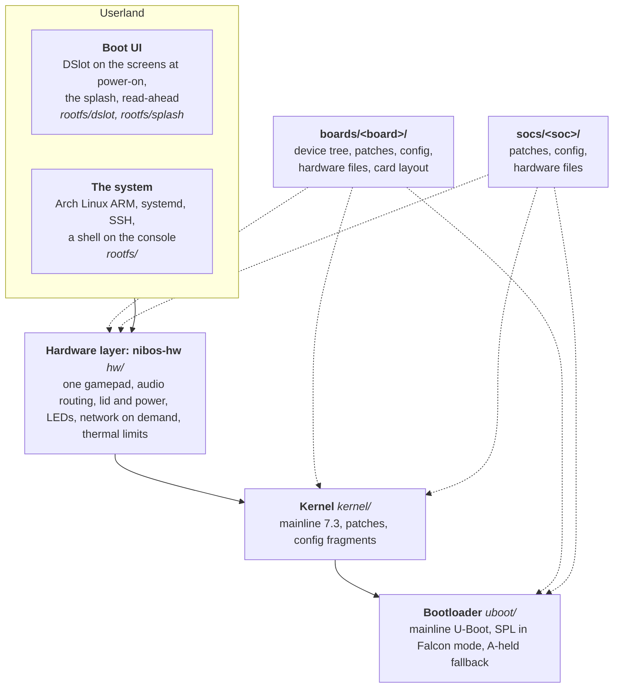
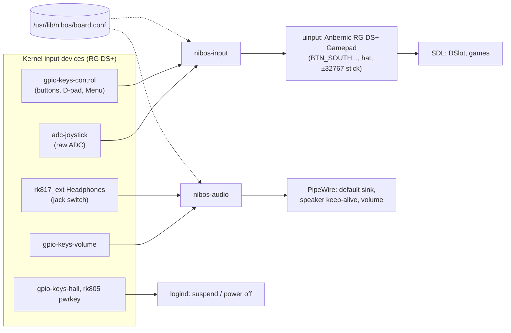

# Architecture

nibOS is a Linux system for small handhelds: mainline Linux and U-Boot, a small hardware layer,
Arch Linux ARM, and a boot UI that starts games. It runs on the Anbernic RG DS+; other boards
are a goal for later. It is built in layers, each a directory of this repository, and each layer
is split by what it applies to: everything, the SoC, or the board.



| Layer | What it owns | Read |
|---|---|---|
| Bootloader | Reset to the kernel's first instruction, and the way back when something breaks | [uboot/README.md](../uboot/README.md) |
| Kernel | Drivers for every part of the board, the configuration, boot-time and suspend fixes | [kernel/README.md](../kernel/README.md) |
| Hardware layer | What makes a board behave like a device: controls, sound, sleep, LEDs, network bring-up | [hw/README.md](../hw/README.md) |
| Root file system | Arch Linux ARM with systemd, built as an image; the boot-time trimming | [rootfs/README.md](../rootfs/README.md) |
| Boot UI | DSlot on the screens at power-on, the splash, read-ahead, a Panfrost-only Mesa | [rootfs/dslot/README.md](../rootfs/dslot/README.md) |
| Boards and SoCs | What only one device or one SoC family needs, for every layer above | [boards/README.md](../boards/README.md), [socs/README.md](../socs/README.md) |

## Generic, SoC, board

Every layer has the same three levels, so a second board on the same SoC would add only a board
directory, and a new SoC a SoC directory and its boards:

| | Generic | SoC (`socs/rk3568/`) | Board (`boards/rg-ds-plus/`) |
|---|---|---|---|
| Kernel patches | The console after the root mount; rtw88 fixes | PMIC early, tuning timeout, modeset off the probe path, the 32 kHz clock | The JD9165 panels |
| Kernel config | `kernel/config/nibos.config`: OS features, what a handheld never uses | `rk3568.config`: the SoC's blocks, other SoCs off | `rg-ds-plus.config`: the board's parts, what it lacks off |
| U-Boot | `bootstage mark`, Falcon through TF-A, short partition scan, fast decompressors | Early data cache, SD clock, UHS SDR104, the 32 kHz clock in SPL | The A-held fallback, the CPU clock, UHS in SPL; config fragments |
| Hardware layer | The daemons, the network target, `nib`, zram, cpufreq, the sleep hook | Deep sleep, drivers kept out of start-up (`soc.conf`) | Device names (`board.conf`), udev, logind, WirePlumber, thermal, iwd, modules |
| Root image | Everything in `rootfs/` | | The stock partitions kept out of systemd |
| Scripts | `kernel/`, `uboot/`, `rootfs/`, `bench/`, `tools/` | `soc.sh`: platform, device tree directory, TF-A | `board.sh`: device tree, U-Boot defconfig, the card's layout |

`NIBOS_BOARD` in `config.sh` picks the board; `config.sh` reads its `board.sh` and its SoC's
`soc.sh`, so every script sees `BOARD_*` and `SOC_*` names instead of literal values.

## Boot chain

On the RG DS+, from power-on:

```mermaid
sequenceDiagram
    participant SPL as TPL + SPL<br/>(sector 64)
    participant TFA as TF-A
    participant K as Linux
    participant S as splash (init=)
    participant SD as systemd
    participant D as DSlot
    SPL->>SPL: DDR init, SD card to UHS SDR104
    SPL->>TFA: load falcon.itb from partition 4
    Note over SPL,TFA: 0.65 s: kernel starts
    TFA->>K: kernel + device tree
    K->>K: panels, PMIC, SD in parallel; mount root
    K->>S: 1.55 s: init
    S-->>S: child: logo on both screens (1.5 s)
    S->>SD: exec systemd
    SD->>D: sysinit.target (~2.7 s)
    D->>D: Mesa, SDL, GL; games listed on a thread
    D-->>S: first GL frame replaces the logo (~5.2 s)
```

Without the splash and with DSlot off, systemd starts the autologin shell on tty1 instead
(`nib boot-ui on|off`). Holding **A** at power-on makes SPL load a fallback U-Boot that boots
`extlinux.conf` on the root partition with the plain command line, never the splash. Why each
step is as fast as it is: [boot-time.md](boot-time.md).

## The SD card

nibOS runs from one card, in TF1 on the RG DS+. A downloadable image has its own layout,
with nothing from the stock firmware: the Falcon FIT, a FAT partition for `provision.toml`, two
root slots, a state partition and the data partition ([design/images.md](design/images.md#the-card)).
A development card starts as a copy of the vendor's stock image instead, so the stock
partitions stay and the stock OS can be put back. Its layout is the board's (`board.sh`); on
the RG DS+:

| Where | What | Written by |
|---|---|---|
| Sectors 64–16383 | TPL + SPL (Falcon) | `uboot/install-falcon.sh` |
| Sector 0x4000 / 0x5000 | U-Boot proper (unused) / the fallback U-Boot (A held) | `uboot/install.sh` |
| Partition 3, "boot" | The kernel as a FIT in the stock layout, for the stock U-Boot | `kernel/deploy.sh` |
| Partition 4, "recovery" | `falcon.itb`: TF-A, the kernel and the DTB with its command line | `kernel/deploy.sh` |
| Partitions 1, 2, 5–10 | The stock OS, untouched | |
| Partition 11, "ROMS" (FAT) | Games, saves, and `ROMS/nibos/`: Wi-Fi networks to import, boot logs, copies of the stock bootloader and partitions | you, and the scripts that keep copies |
| Partition 12, "archroot" (ext4) | The root file system; grows to fill the card on first boot | `rootfs/install-arch.sh` |

The second slot, TF2, is for games (exFAT or FAT, any name, mounted at `/mnt/ds`).

## The hardware layer

`nibos-hw` is one Arch package per board ([hw/](../hw/README.md)): two small Rust daemons and the
configuration files that make the board a device, from the three levels above.



The rest is configuration: udev rules (hide the raw devices, LED triggers, wake sources),
logind and sleep settings, a sleep hook that unbinds devices that can't be suspended,
WirePlumber rules, iwd's power-save quirk, thermal trip points, zram and the network target.
The board's details: [docs/engineering/input.md](engineering/input.md),
[audio.md](engineering/audio.md), [suspend-and-wifi.md](engineering/suspend-and-wifi.md).

## On the device

| | |
|---|---|
| Settings for programs | `/run/nibos/<setting>/<name>`, open to a group, kept by nibOS: [engineering/device-interface.md](engineering/device-interface.md) |
| `nib` | nibOS's command: `nib net` (the network), `nib brightness` (each screen's backlight), `nib boot-ui` (DSlot or the shell at power-on), `nib help` |
| `/usr/lib/nibos/` | `board.conf`, `soc.conf`, the `nib-*` subcommands, the splash, the image's own scripts |
| `/etc/nibos/` | Settings written on the device: the read-ahead list |
| `/run/nibos/` | `backlight/top`, `backlight/bottom`: the screens' backlights by name, writable by the video group; `splash`: when the splash's picture went up (read by DSlot and `bench/boot-ui.sh`) |
| `/var/lib/nibos/` | State: the screens' saved brightness, the speaker amps' active tuning (`firmware/`); on an image, the state partition at `state/` |
| `ROMS/nibos/` | On the card's data partition (ROMS, or NIBOS-DATA on an image), readable from any computer: Wi-Fi networks, boot logs, stock bootloader copies |
| Units | `nibos-input`, `nibos-audio` (user), `nibos-network.target`, `nibos-network-modules`, `nibos-network-deferred`, `nibos-backlight`, `nibos-cpufreq`, `nibos-late-modules`, `nibos-zram`, `nibos-growfs`, `nibos-wifi-import`, `nibos-bootlog`, `dslot` |

## Games

DSlot (a separate project, `DSLOT_SRC`, with its own `dslot` package) is the game shelf, started
by its `dslot.service` from `sysinit.target`. Emulators (such as DSperate, for DS and GBA games)
are separate packages, each describing the systems it plays in
`/usr/share/dslot/emulators/<id>.toml`. Choosing a game, DSlot lets go of both panels, runs the
emulator's command and waits for it, then takes the panels back. nibOS provides the user DSlot
runs as (`$NIBOS_USER`), the games' real-time limit, expedited RCU and the second card
([rootfs/dslot/README.md](../rootfs/dslot/README.md#games)).

## Known shortcuts

Places where nibOS does something simpler than a general-purpose system would, on purpose, with
what replacing them would take:

- **DSlot opens devices with `CAP_DAC_OVERRIDE`.** It starts before udev's coldplug has given
  the DRM and input nodes their groups, outside any logind session, so it has no seat and no
  uaccess ACLs. The alternatives cost boot time (order it after coldplug) or need a seat
  manager (seatd, or a logind session for the unit). The unit is DSlot's (its `dslot` package).
- **No passwords by default.** A development card has none: SSH keys only, `sudo` and polkit
  without a password for `wheel`, and the console logs in by itself. A downloadable image
  behaves the same until `provision.toml` sets a password, and has SSH off until it gives a
  key. It is a single-user handheld; set a password before using it anywhere that matters.
- **The RG DS+'s USB host controller is unbound around sleep**, because suspending it hangs the
  kernel (cause unknown).
- **Board-specific kernel and U-Boot patches.** Five of them buy boot time in ways the upstream
  projects wouldn't take as they are; each patch's message says so and what a general fix
  would be. [engineering/patches.md](engineering/patches.md).

## Principles

- **Mainline everything.** No vendor BSP kernel, no libmali: Panfrost and Mesa give GLES 3.1 and
  a normal Wayland and SDL stack, and fixes arrive for free.
- **Arch Linux ARM**, not a custom minimal image: a real package manager for a system that is
  also a pocket Linux computer. The boot is made fast by configuration, not by leaving systemd.
- **Rust or C for anything that runs on the device**: small static binaries that start in
  milliseconds (the daemons, the splash, read-ahead).
- **Measure before and after.** Every boot-time change was measured from reset, three boots or
  more; changes that didn't pay were taken out ([boot-time.md](boot-time.md)).
- **One board, done properly.** Only the RG DS+ is supported. Other handhelds are a goal for
  later; until then the board layer is just a clean split of what is the RG DS+'s from what
  isn't ([boards/](../boards/README.md)), with no machinery for boards that don't exist.
