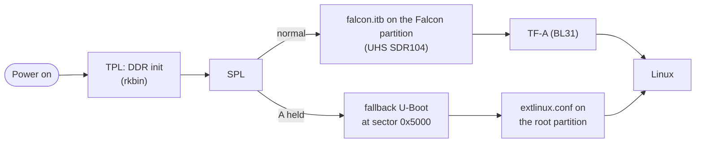

# Bootloader

Mainline U-Boot (v2026.10, `UBOOT_TAG`) for the board in `NIBOS_BOARD`, with generic, SoC and
board patches, in **Falcon mode**: SPL loads TF-A and the kernel itself and starts Linux
directly, with no U-Boot proper in between. On the RG DS+ the kernel starts 0.65 s after reset
(the stock bootloader: about 2.6 s).



Holding **A** at power-on is the way back from anything: SPL then skips UHS and loads a
known-good U-Boot that boots through `extlinux.conf` with the plain command line. A kernel,
splash or bootloader under test that hangs costs a restart, not a trip to a card reader.

| Path | What |
|---|---|
| [`patches/`](patches/README.md) | The generic patches, and the investigation-only sets |
| [`build.sh`](build.sh) | Builds U-Boot at `UBOOT_TAG` with the three patch sets, the board's defconfig and config fragments, and DDR init and TF-A from rkbin at `RKBIN_COMMIT` |
| [`mkfalcon.py`](mkfalcon.py) | Makes the Falcon FIT: TF-A's segments, the uncompressed kernel and the DTB with `/memory` and bootargs filled in (`kernel/deploy.sh` runs it) |
| [`install.sh`](install.sh), [`install-falcon.sh`](install-falcon.sh) | Install U-Boot, the fallback U-Boot and the Falcon SPL on a running device, keeping the stock bootloader first |
| [`restore-stock.sh`](restore-stock.sh) | Writes the stock bootloader back from a Mac when the device doesn't start |
| [`measure.sh`](measure.sh), [`bootstage.py`](bootstage.py) | The bootloader's own stage timings, read back from Linux (with [`tools/device/`](../tools/device/)'s `counter` and `memdump`) |

What the SoC and the board add: [`socs/rk3568/uboot/`](../socs/rk3568/uboot/) and
[`boards/rg-ds-plus/uboot/`](../boards/rg-ds-plus/uboot/); the card layout the scripts use is
the board's [`board.sh`](../boards/rg-ds-plus/board.sh). Why each patch exists:
[docs/engineering/patches.md](../docs/engineering/patches.md).

## Builds

`build.sh` runs in the build machine. The variants are environment variables:

| Build | Output | What it is |
|---|---|---|
| `build.sh` | `out/u-boot-rockchip.bin` | U-Boot proper with every patch: boots `extlinux.conf`, no UEFI, CPU at 1608 MHz to unpack the kernel. Installed at 0x4000, unused once Falcon is in |
| `FALLBACK=1 build.sh` | `out/u-boot-fallback.itb` | The first U-Boot that booted (generic 0001–0002 only): the A-held way back, at 0x5000 |
| `FALCON=1 build.sh` | `out/idbloader-falcon.img` | TPL + SPL that boot the Falcon FIT, with UHS SDR104 and the PMIC in SPL |
| `MEASURE=1 build.sh` | `out/u-boot-rockchip.bin` | Marks every step as a boot stage, for `measure.sh` (never left installed) |
| `FALCON=1 FALCON_DEBUG=1` | `out/idbloader-falcon.img` | SPL writes breadcrumbs to the SD card: the only window into a Falcon boot without a serial console |

## Install (once, with the device running nibOS; in this order)

```bash
uboot/install.sh                 # keeps the stock bootloader on ROMS/nibos/, then U-Boot at 0x4000
uboot/install.sh --fallback      # the known-good U-Boot at 0x5000 (A held at power-on)
uboot/install-falcon.sh          # SPL in Falcon mode at sector 64; the Falcon partition gets the FIT
```

Everything is on the one SD card: on an RG DS+ development card the bootloader area (sectors
64–24575) and partitions 3, 4 and 12. A downloadable image comes with SPL and the fallback
already in place ([docs/design/images.md](../docs/design/images.md#the-card)), built with
`FALCON=1` and `FALLBACK=1 ROOT_PART=3`. The partition table is never touched. If the card doesn't boot at all:
[docs/recovery.md](../docs/recovery.md).

## What makes it fast

From reset to the kernel's first instruction, 0.65 s: DDR init ~0.1 s, SPL bringing the card
up at UHS SDR104 (rk817 over I²C, the 1.8 V switch, tuning) by 0.31 s, reading the 17.5 MB
uncompressed kernel in 0.25 s (69 MB/s), TF-A at ~0.6 s. The steps that got it there, each a
patch or a config line in `build.sh` with its reason:

- **Falcon mode** (`generic/0002`): no U-Boot proper, so no relocation, driver model rebuild,
  boot command or decompression. It only pays because SPL reads at UHS (`rk3568/0003`,
  `rg-ds-plus/0003`): at High Speed the uncompressed kernel took 0.73 s and lost to U-Boot
  proper.
- **UHS SDR104 in U-Boot** (`rk3568/0003`): 1.8 V signalling, IO-domain switching in the safe
  order, CRU clock phases and tuning, none of which U-Boot had for the RK3568.
- For U-Boot proper (the path before Falcon, and still the fallback's): the data cache on
  before relocation (U-Boot spent 0.92 s there; afterwards 0.14 s to its boot command), the SD clock really at 50 MHz, no UEFI disk objects, a
  partition scan that stops early, decompressors built for speed, the CPU at 1608 MHz.
- **No hash checks in SPL**: there is no secure boot here, and SHA-256 over the kernel costs
  more than it's worth.

Measured with `bench/boot.sh` and `measure.sh` ([bench/results/bootloader.md](../bench/results/bootloader.md)). More in
[docs/boot-time.md](../docs/boot-time.md).

## Things worth knowing

- **Suspend needs the PMU's 32 kHz clock running.** Only U-Boot proper's clock driver opened
  its gate; under Falcon every suspend hung in TF-A until SPL opened it too (`rk3568/0004`;
  [the story](../docs/engineering/suspend-and-wifi.md)).
- **A/B slots.** Before loading the Falcon FIT, SPL reads the boot control block at the end of
  the Falcon partition and picks slot A's or slot B's FIT, counting tries on an unconfirmed slot
  and rolling back by itself (`rg-ds-plus/0004`; A held is checked first). A slot on trial
  boots with the hardware watchdog running (`rg-ds-plus/0005`), so a hang before systemd
  uses up the try too.
  [docs/design/ab-rollback.md](../docs/design/ab-rollback.md).
- SPL rejects a FIT configuration without a `description` before loading anything;
  `mkfalcon.py` writes one.
- On the RG DS+, U-Boot's `mmc 1` is the TF1 card; the root file system is partition 12
  (`mmc 1:c`), from `BOARD_UBOOT_MMC` and `BOARD_ROOT_PART`.
- The RG DS defconfig powers the device off when the charger turned it on, and the PMIC
  remembers that across restarts. The board's fragment turns that off: plugging in should
  charge.
- The build is reproducible: with `SOURCE_DATE_EPOCH` set, the three variants above come out
  byte for byte the same.
